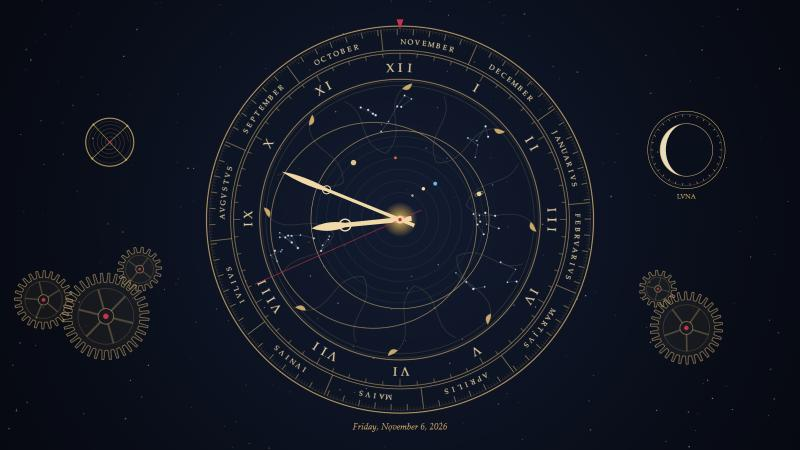
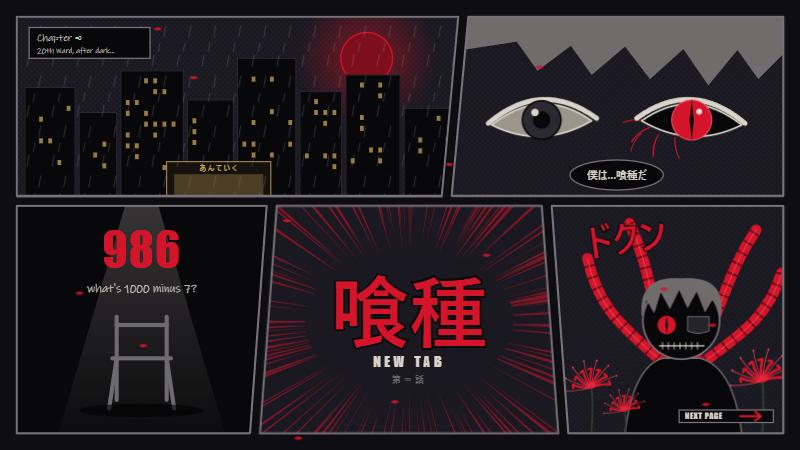
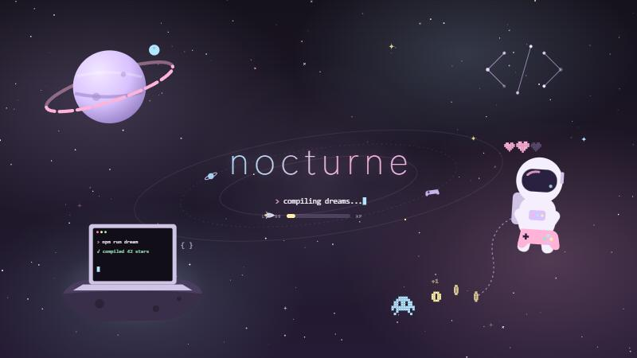

# Firefox Living Themes

Five animated themes for Firefox. All the art and sound is original and generated locally, and nothing loads from the internet.

Built and tested on **Firefox 159 on Windows 11**. Other versions and systems may need small fixes (see [Contributing](CONTRIBUTING.md)).

| Meridian | Manga: Ghoul | Nocturne |
|---|---|---|
|  |  |  |

*These show the new tab artwork rendered outside Firefox. Real screenshots of all five themes are welcome as contributions.*

## Two editions

| | **CSS-only** (`css-only/`) | **Full** (`chrome/`) |
|---|---|---|
| What it is | Pure CSS, nothing else | CSS plus a small script per theme |
| Installs outside your profile | Nothing | Optional loader in Firefox's program folder (admin) |
| Switching themes | A toggle in `about:config`, live, no restart | Palette button or Ctrl+Alt+T |
| Meridian's new tab | Animated instrument, no live time or date | Live clock with real time, date, planets and moon phase |
| Music | None | Ame, Relics and Meridian |
| Everything else | Same | Same |

**Not sure? Start with CSS-only.** It's the simplest and safest, and you can switch to the full edition later by re-running the installer.

## The themes

- **Meridian:** a brass astronomical clock on midnight blue, with turning rings, orbiting planets, meshing gears and a moon dial. In the full edition the clock shows your real time and date, with a soft tick and a music box.
- **Nocturne:** pastel space and pixel games, with a bookmarks dock that magnifies, a rocket loading bar, a walking pixel critter, 20 colour palettes and a Game Over page when you're offline.
- **Ame:** a rainy neon city seen from a loft window, with a black cat and a passing train. The full edition adds lo-fi rain music.
- **Relics:** a moonlit Japanese room lit by a paper lantern, with nods to favourite shows and games. The full edition adds koto music.
- **Manga: Ghoul:** a dark manga page inspired by Tokyo Ghoul, with a red eye, spider lilies, a "1000 − 7" countdown and Japanese sound effects on your buttons.

## Setup (Windows)

### Install

1. On this page, click **Code → Download ZIP**, then unzip it anywhere.
2. **Close Firefox completely.**
3. Open the unzipped folder, click the address bar at the top of the window, type `powershell` and press Enter.
4. Run **one** of these:
   - CSS-only edition:
     ```powershell
     powershell -ExecutionPolicy Bypass -File install.ps1 -CssOnly
     ```
   - Full edition:
     ```powershell
     powershell -ExecutionPolicy Bypass -File install.ps1
     ```
5. Start Firefox. You should see Nocturne.

The installer backs up your existing `chrome` folder first and needs no admin rights. It only touches the profile's `chrome` folder and one line in `user.js`. The CSS-only option also adds the theme switches to `prefs.js` while Firefox is closed, so they're ready to toggle in `about:config`.

### Full edition only: install the theme loader

**Firefox can't run a theme's scripts by itself. This step adds the palette button, Ctrl+Alt+T, the live Meridian clock and the music.** Without it, the full edition still looks right, and you switch themes in `about:config` like the CSS-only edition.

> **Security trade-off, please read.** This adds two files to Firefox's program folder that run every theme's `chrome.js` with **full access to Firefox and your files**. The scripts here only build the interface and synthesise music, and you can read them yourself: `loader/theme-loader.cfg` and `chrome/themes/*/chrome.js`. But once the loader is installed, any `chrome.js` placed in those folders will run with that same access, so only add themes you trust.

1. Close Firefox.
2. Open **PowerShell as administrator** and go to the unzipped folder:
   ```powershell
   cd "C:\path\to\the\unzipped\folder"
   ```
3. Run:
   ```powershell
   powershell -ExecutionPolicy Bypass -File loader\install-loader.ps1
   ```
4. Start Firefox. The palette button appears next to the ☰ menu.

### Other systems

macOS and Linux should work but **haven't been tested**, and `install.ps1` is Windows-only. To install by hand:

1. Open `about:support` in Firefox and click **Open Folder** next to *Profile Folder*.
2. Close Firefox, then copy into the profile folder:
   - the `chrome` folder from `css-only/` (CSS-only) or from the repo root (full);
   - `user.js`. If you already have one, add its line to yours instead of replacing it.
3. Full edition only, for the loader: copy `loader/theme-loader.cfg` next to the Firefox program, and `loader/defaults/pref/autoconfig.js` into its `defaults/pref/` folder. On macOS these go inside `Firefox.app/Contents/Resources/`.

## Using it

- **Switch themes in `about:config`:** open `about:config?filter=.active` and set **one** of `relics.active`, `ame.active`, `manga.active` or `meridian.active` to true. Set them all to false for Nocturne. The change is live. If a switch is missing, create it as a Boolean. Tip: bookmark `about:config?filter=.active` and name it **Themes**.
- **Switch with the full edition and loader:** use the palette button next to ☰, or press **Ctrl+Alt+T**.
- **Stop the animations:** set `<theme>.freeze` to true in `about:config` (for example `nocturne.freeze`), or use **Freeze animations** in the palette menu.
- **Music (full edition):** it plays only on the new tab page. Click the button at the end of the tab bar to mute it, and scroll on it to change the volume.
- **Bookmark icons:** bookmarks-bar folders named `AI`, `Social`, `Piracy`, `Tetris`, `TFT`, `Chess`, `Linux` or `Other`, and a bookmark named `Freeze`, get custom icons. Change the names in each theme's CSS to suit your own.

## Good to know

- **New tab page:** themes that draw over the new tab may hide or cover its search box and shortcuts. Search from the address bar.
- **Private windows:** each theme has a private look. In the full edition, Meridian covers the private-browsing page, so search from the address bar there too.
- **Firefox updates** can change internal names and break some styling. Please open an issue if they do.

## Uninstall

1. Close Firefox.
2. In your profile folder, delete `chrome`, or replace it with the `chrome-backup-...` folder the installer made.
3. If you installed the loader, delete `theme-loader.cfg` and `defaults\pref\autoconfig.js` from `C:\Program Files\Mozilla Firefox`.
4. Optional: remove the line this added to `user.js`, then set `toolkit.legacyUserProfileCustomizations.stylesheets` to false in `about:config`.

## Contributing

New themes, fixes and macOS or Linux testing are welcome. See [CONTRIBUTING.md](CONTRIBUTING.md).

## Credits and license

Code and original art are under the [MIT License](LICENSE).

This is an unofficial fan project, not affiliated with or endorsed by Mozilla or the creators of the works it nods to. Tokyo Ghoul, The Mentalist and the other referenced titles belong to their respective owners. The artwork here is original and contains no material copied from those works.
